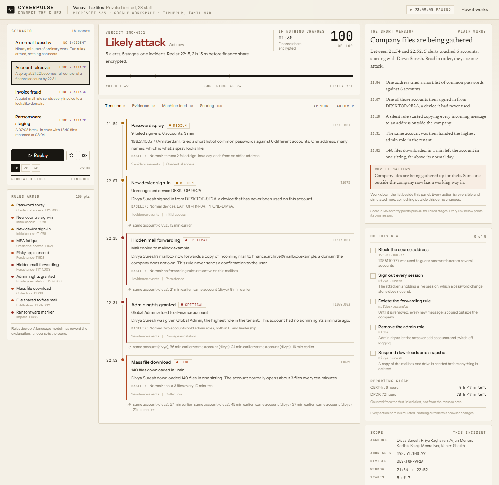

# CyberPulse

An early-warning system for small businesses. It reads the logs a small firm already keeps, connects related suspicious events into one explained incident, and tells the owner what to do before the damage.

Built for **DEXATHON 2026** by **Team QUADRAX** (team DEX26335), theme: Cybersecurity.



## The problem

A small business does not get attacked by one dramatic event. It gets attacked by a chain of ordinary-looking ones: a few failed passwords, a sign-in from a new device, a mail rule nobody remembers creating, an admin role granted after hours. Each event alone is a shrug. Together they are an attack, and nobody is watching.

Roughly 96 percent of ransomware victims, where size is known, are small or midsize businesses (Verizon DBIR 2026). 43 percent of Indian SMBs have no dedicated security team (ESET 2024). Existing tools either need an analyst (SIEM) or never connect events at all (antivirus, cloud alerts).

CyberPulse sits in that gap.

## What this repository is

A complete, working frontend prototype. Everything runs in the browser: the detection engine, correlation, scoring, explanation, and response guidance. There is no backend, no API key, and no network call at runtime. The demo works offline.

The app loads synthetic telemetry from a 28-person garment exporter in Tiruppur, streams it through ten written rules, links alerts that share an account, an address or a device, and turns the result into one incident with a visible score and plain-language advice.

## Quick start

```bash
npm install
npm run dev
```

Open the printed URL. Four scenarios are available in the left rail:

| Scenario | What it shows | Expected verdict |
| --- | --- | --- |
| A normal Tuesday | 90 minutes of ordinary work, nothing connects | No incident |
| Account takeover | Password spray at 21:54 becomes admin control by 22:31 | Likely attack |
| Invoice fraud | A mail rule quietly redirects invoices | Likely attack |
| Ransomware staging | A 02:08 break-in ends with 1,840 files renamed | Likely attack |

Press **Play**, or use **Skip to the end** to jump straight to the finished incident. Speed is 1x, 2x or 4x.

### Deep links

The app accepts query parameters, which is handy for a live demo or a shared link:

```
/?scenario=takeover&t=end
/?scenario=ransomware&t=end&tab=score
/?scenario=invoice&tab=evidence
```

- `scenario`: `normal`, `takeover`, `invoice`, `ransomware`
- `t=end`: jump to the final state
- `tab`: `timeline`, `evidence`, `machine`, `score`

## How it works

```
synthetic logs  ->  detect  ->  connect  ->  score  ->  explain  ->  respond
```

**Detect.** Ten transparent rules evaluate a frozen event schema. Every rule prints the metric that fired it and the baseline it was compared against.

| Rule | Detects | Severity | Stage | MITRE |
| --- | --- | --- | --- | --- |
| Password spray | Many accounts tried from one address | Medium | Credential access | T1110.003 |
| New country sign-in | A country this account never used | High | Initial access | T1078 |
| New device sign-in | A device this account never used | Medium | Initial access | T1078 |
| MFA fatigue | Repeated push denials, then one approval | High | Credential access | T1621 |
| Risky app consent | A new app granted mail access | High | Persistence | T1528 |
| Hidden mail forwarding | Inbox silently copying mail outside | Critical | Persistence | T1114.003 |
| Admin rights granted | A normal account made an admin | Critical | Privilege escalation | T1098.003 |
| Mass file download | Downloads far above the account norm | High | Collection | T1039 |
| File shared to free mail | A company file sent to personal mail | High | Exfiltration | T1567.002 |
| Ransomware marker | Backups deleted or files mass renamed | Critical | Impact | T1486 |

**Connect.** Alerts that share an account, a source address or a device within six hours are joined into one incident. Shared office addresses and kiosk machines are ignored on purpose so unrelated people are never linked. Every link displays its own reason and the gap in minutes.

**Score.** The formula is printed in the app:

```
severity points (low 5, medium 15, high 25, critical 40)
+ 10 for every extra attack stage
capped at 100
```

Bands: Watch 1 to 39, Suspicious 40 to 74, Likely attack 75 and above.

**Explain.** Each alert has a short plain-language sentence. The incident story, the "why it matters" line and the action list are generated from the rule evidence. A language model may reword the prose; it never sees the decision and never sets the score.

**Respond.** Actions are ordered by what stops the damage first, and each one says what would change once it is done. All actions are simulated.

## Design notes

The interface is deliberately not a dark-neon security console. The audience is a business owner without a security team, so the product reads like a report: warm paper surfaces, a single rust accent, monospace for machine evidence, a serif for the human explanation. The same incident appears twice on screen: once as a machine timeline with rule ids, and once as a plain-language story.

No color is used decoratively. Rust and crimson always mean something is wrong.

## Project structure

```
src/
  lib/
    types.ts        event, alert, incident, story types
    org.ts          the 28-person firm, devices, baselines, ignored entities
    rules.ts        the ten rules
    correlate.ts    union-find linking, incident assembly, link reasons
    explain.ts      plain-language story and response actions
    scenarios.ts    four scripted scenarios, deterministic
    analyze.ts      the full pipeline in one call
  hooks/
    useSimulation.ts  playback clock, speed, seek
  components/       UI surfaces
```

Adding a rule means adding one function in `rules.ts` and one entry in the `RULES` table. Nothing else changes.

## Scripts

```bash
npm run dev      # local dev server
npm run build    # type check and production build
npm run preview  # preview the production build
npm run lint     # oxlint
```

## Data and honesty

Every address comes from documentation ranges (192.0.2.0/24, 198.51.100.0/24, 203.0.113.0/24). Every domain ends in `.example`. Every person, device and number is invented. No real system is contacted at any point.

## Impact references

- Verizon DBIR 2026: ransomware in 48 percent of breaches; about 96 percent of victims, where size is known, were small or midsize.
- ESET SMB study 2024: 43 percent of Indian SMBs have no dedicated security team.
- CERT-In 2024: 20.4 lakh incidents tracked, up 76 percent since 2020.
- DPDP Rules 2025: 72-hour breach report, penalties up to 25 crore rupees per instance.
- MITRE ATT&CK: detection stages mapped to tactics.

## Team

S Sreevathson (lead), K Keerthana, Harish Karthick C, Aswin Kumaran P.

Team QUADRAX, DEXATHON 2026, Department of Computer Applications, Sathyabama Institute of Science and Technology.
